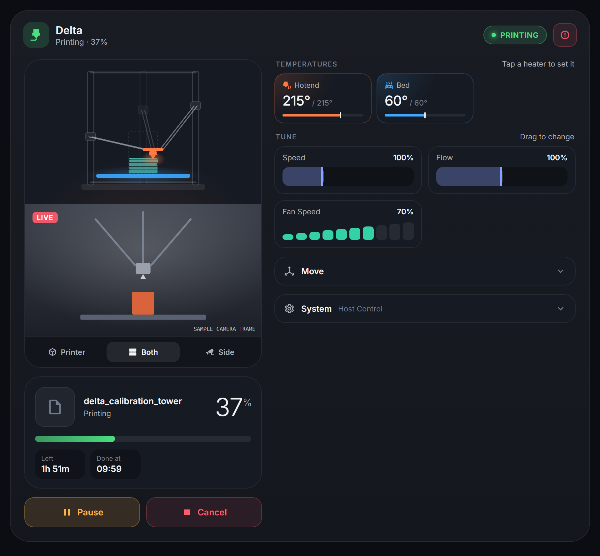
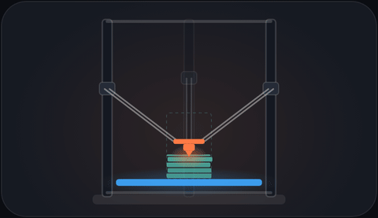
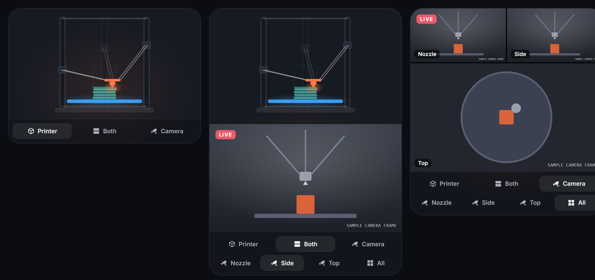
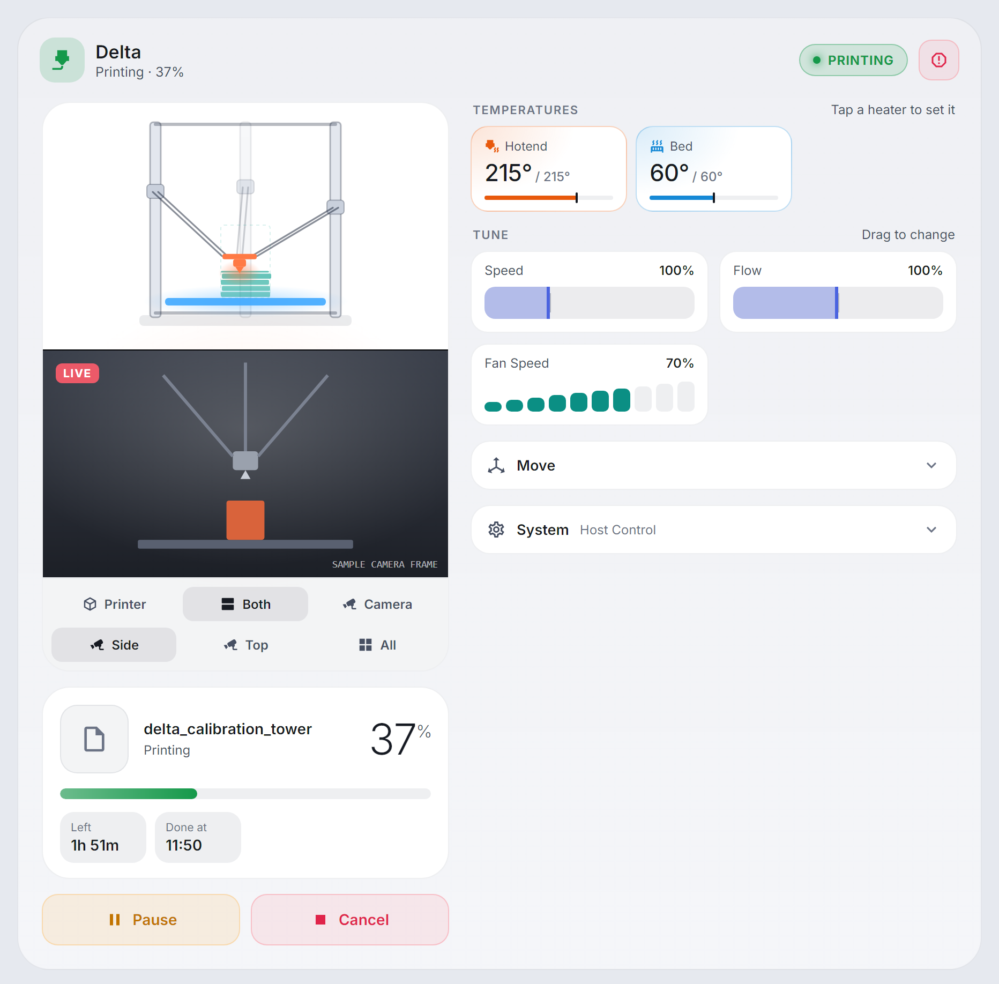
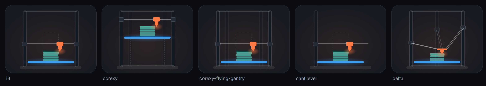

# Lovelace 3D Printer Card — GhVost fork

A custom Lovelace card for monitoring and controlling **Moonraker/Klipper** and **OctoPrint** 3D printers from Home Assistant. Single file, no dependencies, no build step.

This is a fork of [gilbertorconde/lovelace-3d-printer-card](https://github.com/gilbertorconde/lovelace-3d-printer-card) by [gil](https://github.com/gilbertorconde). It contains everything from the original card (currently up to 3.1.0) plus the additions below, and installs on its own from this repository's releases — see [Installation](#installation). The card type is the same, `custom:lovelace-3d-printer-card`, so switching between the original and the fork needs no dashboard changes.

---

## What this fork adds

| Feature | Details |
|---|---|
| **OctoPrint support** | A built-in entity mapping, picked automatically when Home Assistant's OctoPrint integration is found (English and German HA). An optional [helper package](examples/octoprint_package.yaml) adds emergency stop, homing, jogging, speed/flow and fan control. See [OctoPrint](#octoprint) |
| **Delta printers** | `printer_type: delta` — a side view in which the effector sweeps and the carriages follow it on constant-length rods |
| **Camera split view** | A Printer / Both / Camera toggle under the live view; **Both** stacks the drawing above the camera. `view:` sets the starting mode |
| **All cameras at once** | With two or more cameras, **All** shows them together: one column on narrow views, two columns from 440 px |
| **Light theme** | `theme: light`, or `theme: auto` to follow Home Assistant's dark mode. See [Themes](#themes) |
| **Restyled drawings** | All printer drawings match the delta's style |
| **New mapping keys** | `ignore`, `hide_unavailable`, `status_map`, `label_strip` for writing mappings of other integrations |

OctoPrint, delta and the split view are offered upstream in [pull request #10](https://github.com/gilbertorconde/lovelace-3d-printer-card/pull/10). **All cameras** and the **light theme** are only in this fork. Whatever happens to the pull request, the fork stays installable and keeps following upstream.

---

## Features

Version 3 is an app-style design, dark by default with a light theme: everything you use during a print is on one page, and the less frequent controls are folding sections.

- **Live view** — an animated drawing of the printer (i3, CoreXY, CoreXY flying gantry, cantilever or delta) with the part growing layer by layer, heaters glowing while they have a target and the toolhead moving while printing. The toggle switches between the drawing, drawing plus camera (**Both**) and the camera alone. With several cameras you pick one, or **All** (live `<ha-camera-stream>`, with rotation)
- **Progress** — file name with its thumbnail, percent, time left, finish time, elapsed time and layer
- **Pause / Resume / Cancel** — Cancel needs a second tap. Emergency stop sits in the header and also needs two taps
- **Temperatures** — a tile per heater with current and target. Tap a heater to set its target with + / − or presets (PLA / PETG / ABS by default)
- **History** — tap any reading (temperature, progress, times, speed, fans, position, totals) for Home Assistant's more-info dialog with its graph
- **Tune** — speed and flow sliders, and 10-step drag bars for fans, filters and lights
- **Move** — X/Y/Z position, homing, step sizes and a jog pad (disabled while printing)
- **Macros** and **System** (Klipper, service and host restarts) as folding sections
- **Message banner** for Klipper messages, tinted red on errors
- **Smart plug** — `power_switch` adds a power button. Turning it off mid-print needs a second tap. With the plug off the card shows a Turn on button and the printer's lifetime totals, and the cameras keep working
- **`variant: compact`** — a small glance card with progress and temperatures. "Full controls" opens the full card in a dialog
- **Auto-discovery** — all entities are found from the `base_entity` prefix
- Two columns when the card is wide, one column on a phone. The header never squashes its buttons

---

## Screenshots

| OctoPrint delta printer, printing, camera split view (**Both**) |
|:---:|
|  |

| Delta animation while printing |
|:---:|
|  |

| Live view: Printer · Both · Camera with **All** cameras, stacked on a narrow view and in two columns on a wide one |
|:---:|
|  |

| Light theme (`theme: light`) |
|:---:|
|  |

| Printing (wide), hotend target open |
|:---:|
|  |

| Phone width | Paused, with a Klipper message |
|:---:|:---:|
|  |  |

| Smart plug off |
|:---:|
|  |

| `variant: compact` printing | `variant: compact` off |
|:---:|:---:|
|  |  |

| Printer types |
|:---:|
|  |

The screenshots use sample data; the camera pictures are placeholders.

---

## Installation

> **Already using the original card?** Install only one of the two, or both register the same card. In HACS, open the original **Lovelace 3D Printer Card**, choose **Remove**, then follow Option A. For a manual install, replace the files in place (Option B). Your dashboard YAML needs no changes. To go back, remove the fork and add `https://github.com/gilbertorconde/lovelace-3d-printer-card` the same way.

### Option A — HACS (recommended)

[](https://my.home-assistant.io/redirect/hacs_repository/?owner=GhVost&repository=lovelace-3d-printer-card&category=dashboard)

Or by hand:

1. In Home Assistant, open **HACS**.
2. Click the three-dot menu (⋮) in the top-right and choose **Custom repositories**.
3. Paste `https://github.com/GhVost/lovelace-3d-printer-card` and select **Dashboard** as the type.
4. Click **Add**, then search for **Lovelace 3D Printer Card**, open the entry whose repository is `GhVost/lovelace-3d-printer-card`, and download it.
5. Reload your browser / clear the cache.

HACS installs the fork's latest release and offers updates when a new one is published. Fork versions end in `-ghvost` (e.g. `3.2.0-ghvost`).

### Option B — Manual

1. Download `lovelace-3d-printer-card.js` and the `entities/` folder from the fork's [latest release](https://github.com/GhVost/lovelace-3d-printer-card/releases/latest).
2. Copy the card to `/config/www/lovelace-3d-printer-card/lovelace-3d-printer-card.js` and the `entities/` folder to `/config/www/lovelace-3d-printer-card/entities/`.
3. In **Settings → Dashboards → Resources**, add each file as a resource (type: **JavaScript Module**). Click **Add resource**, enter the URL, then add the next:
   - `/local/lovelace-3d-printer-card/lovelace-3d-printer-card.js` (the card)
   - `/local/lovelace-3d-printer-card/entities/en_generic.js`
   - `/local/lovelace-3d-printer-card/entities/de_generic.js`
   - `/local/lovelace-3d-printer-card/entities/de_bambu_generic.js`
   Add each entity mapping file you use; see the `entities/` folder for available options. The OctoPrint mapping is built into the card and needs no file.

---

## Add the card to your dashboard

**Minimal config** — the card discovers all entities automatically:

```yaml
type: custom:lovelace-3d-printer-card
name: Voron 2.4
base_entity: voron_24
printer_type: i3
```

**With camera rotation and a starting view:**

```yaml
type: custom:lovelace-3d-printer-card
name: Voron 2.4
base_entity: voron_24
printer_type: i3
view: both
cameras:
  - entity: camera.voron_24_back
    rotate: 180
  - entity: camera.voron_24_top
    rotate: 90
```

**With entity mappings (e.g. German UI):**

```yaml
type: custom:lovelace-3d-printer-card
name: Voron 2.4
base_entity: voron_24
entity_mappings: de_generic
```

**BambuLab with German HA** — use `de_bambu_generic` when the BambuLab integration exposes German entity names:

```yaml
type: custom:lovelace-3d-printer-card
name: Bambu P1S
base_entity: x1c_myprinter
entity_mappings: de_bambu_generic
```

**Check the `entities/` folder** in the repo to see which mapping files are available (e.g. `en_generic.js`, `de_generic.js`, `de_bambu_generic.js`). Use the filename without `.js` as the value.

**Compact glance card** (e.g. inside a room view), opening the full card in a dialog:

```yaml
type: custom:lovelace-3d-printer-card
name: Voron 2.4
base_entity: voron_24
printer_type: corexy-flying-gantry
power_switch: switch.printer_smart_plug
variant: compact
```

**Your own temperature presets:**

```yaml
presets:
  hotend: [{ name: PLA, value: 210 }, { name: ASA, value: 255 }]
  bed: [60, 105]
  number.voron_24_heater_chamber_target: [{ name: ABS, value: 50 }]
```

**With a smart plug power button:**

```yaml
type: custom:lovelace-3d-printer-card
name: Voron 2.4
base_entity: voron_24
power_switch: switch.printer_smart_plug
```

---

## OctoPrint

For Home Assistant's built-in OctoPrint integration. The mapping is built into the card and picked automatically when `sensor.<base_entity>_current_state` and `sensor.<base_entity>_actual_tool0_temp` exist, so `entity_mappings` can be left out (or set it to `octoprint`). It works with English and German HA.

```yaml
type: custom:lovelace-3d-printer-card
name: Delta
base_entity: octoprint
printer_type: delta
view: both
```

Out of the box, hotend/bed targets are settable via the integration's number entities, and pause/resume/cancel and the OctoPrint restart/reboot/shutdown buttons are mapped. The integration itself has no G-code service, fans, speed factor or emergency stop, so on its own Move, Tune and the emergency-stop button don't appear.

To get them, add the helper package [`examples/octoprint_package.yaml`](examples/octoprint_package.yaml). It lets Home Assistant send G-code through OctoPrint's REST API (server-side, so no CORS or HTTPS setup is needed) and creates entities the card picks up automatically:

| Entity | Card control | G-code |
|---|---|---|
| `button.octoprint_emergency_stop` | red emergency-stop button | `M112` |
| `button.octoprint_home_all_axes`, `…_home_x_axis`, `…_home_y_axis`, `…_home_z_axis` | Move → Home | `G28` |
| `script.octoprint_jog` | Move → jog arrows | `G91` / `G0` / `G90` |
| `number.octoprint_speed_factor`, `number.octoprint_flow_factor` | Tune → Speed, Flow | `M220`, `M221` |
| `number.octoprint_fan_speed` | Tune → fan bars | `M106` |

Setup:

1. Enable packages in `configuration.yaml` (once):
   ```yaml
   homeassistant:
     packages: !include_dir_named packages
   ```
2. Copy the example to `/config/packages/`, replace `OCTOPRINT_HOST` with your OctoPrint address.
3. Add your OctoPrint API key (OctoPrint → Settings → Application Keys) to `secrets.yaml` as `octoprint_api_key`.
4. Check the configuration and restart Home Assistant.

OctoPrint doesn't report speed, flow or fan values, so those show the last value set from Home Assistant. The toolhead position isn't available, so Move shows no X/Y/Z readout. Entity IDs follow the names in the file; if your `base_entity` isn't `octoprint`, rename them to match.

---

## Config Reference

| Key | Type | Required | Description |
|---|---|---|---|
| `base_entity` | string | **Yes** | Entity name prefix, e.g. `voron_24` |
| `name` | string | No | Display name shown in the card header |
| `printer_type` | string | No | `i3` (default), `corexy`, `corexy-flying-gantry`, `cantilever`, or `delta` |
| `entity_mappings` | string | No | Entity mapping + UI locale. **Check the `entities/` folder** for available options (e.g. `en_generic`, `de_generic`, `de_bambu_generic`), or the built-in `octoprint`. Default: `octoprint` when OctoPrint entities are detected, else `{hass.locale}_generic` or `en_generic` |
| `cameras` | list | No | Array of `{ entity, rotate, aspect }` overrides: rotation in degrees, aspect ratio such as `4:3` (default `16:9`) |
| `power_switch` | string | No | Switch entity ID for the printer's smart plug — adds a power button to the header |
| `view` | string | No | Starting live view: `printer` (default), `both` (drawing above the camera) or `camera`. The toggle under the view switches it, and the choice is remembered per browser |
| `variant` | string | No | `full` (default) or `compact`: a glance card whose "Full controls" opens the full card in a dialog |
| `theme` | string | No | `dark` (default), `light`, or `auto` (light or dark following Home Assistant's dark mode) |
| `presets` | map | No | Target presets per heater, keyed by `hotend`, `bed`, a heater's sensor or target entity ID, or its label. Each item is `{ name, value }` or a number. Defaults: hotend PLA 215 / PETG 245 / ABS 260, bed PLA 60 / PETG 80 / ABS 100 |

---

## Themes

The card is dark by default. `theme: light` switches it to light surfaces with darker accent colours, so status, heater and fan colours keep their contrast; the printer drawing is restyled to match. `theme: auto` follows Home Assistant: light when your profile or theme is in light mode, dark otherwise. The camera picture and its labels stay dark in both themes.

```yaml
type: custom:lovelace-3d-printer-card
name: Voron 2.4
base_entity: voron_24
theme: auto
```

---

## Cameras

Cameras are fully auto-discovered from `camera.*<base>*` entities (the thumbnail camera is excluded). Only the shown cameras stream, through HA's native `<ha-camera-stream>` element (MJPEG, HLS, WebRTC).

The toggle under the live view switches between **Printer** (the drawing), **Both** (the drawing above the camera) and **Camera** (the camera alone); `view:` sets the starting mode. With two or more cameras, a second row picks the camera, and **All** shows every camera at once, each tile labelled and keeping its own aspect ratio and rotation. The layout follows the live view's width: below 440 px (phones, and the left column of a wide card) the cameras are stacked in one column; from 440 px they sit in two columns, and an odd last camera spans both. Both choices are remembered per browser. **All** streams every camera, so it uses more bandwidth.

The `cameras:` config array is only needed for rotation or a non-16:9 aspect ratio. Unspecified cameras default to `rotate: 0`.

```yaml
cameras:
  - entity: camera.printer_back
    rotate: 180    # flip upside down
  - entity: camera.printer_top
    rotate: 90     # rotate 90° clockwise
    aspect: "4:3"
```

| Value | Result |
|---|---|
| `0` | No rotation (default) |
| `90` | Rotate 90° clockwise |
| `180` | Flip upside down |
| `270` | Rotate 90° counter-clockwise |

---

## Printer Types

| Value | Description |
|---|---|
| `i3` | Prusa i3 / Cartesian — two Z rods, X gantry, moving bed |
| `corexy` | CoreXY — gantry fixed at top, bed moves down with object |
| `corexy-flying-gantry` | CoreXY Voron 2.4 — flying gantry moves up with object, fixed bed |
| `cantilever` | Cantilever (Ender-style) — single upright, cantilevered X arm |
| `delta` | Delta (Kossel/Rostock) — side view: three towers (back one faint), carriages and arm pairs follow the effector |

---

## How Auto-Discovery Works

On every update the card performs a single pass over `hass.states`, visiting every entity whose ID contains `base_entity`. Each entity is classified by domain and name suffix.

### Hidden entities

Any entity with `attributes.hidden === true` is skipped entirely. This filters out service-management buttons (stop/start/restart klipper, moonraker, crowsnest, etc.) that Moonraker marks hidden in the HA registry.

### Well-known roles — sensor

| Role | Matched suffix(es) |
|---|---|
| Status | `current_print_state` (values: `standby`, `printing`, `paused`, `complete`, `cancelled`, `error`) |
| Printer state | `printer_state` (values: `ready`, `startup`, `shutdown`, `error`) — combined with status for display; `error`/`shutdown`/`startup` take precedence |
| Progress | `progress` |
| Duration | `print_duration` (Moonraker: unit `min`) |
| ETA | `print_time_left` (preferred, unit `h`), `print_eta` (fallback, ISO timestamp) |
| Filename | `filename` |
| Current layer | `current_layer` |
| Total layers | `total_layer` (with or without trailing `s`) |
| Filament used | `filament_used` |
| Message | `current_print_message`, `current_display_message` (combined; banner hidden if both empty) |
| Hotend temp | `extruder_temperature`, `extruder_temp` |
| Bed temp | `bed_temperature`, `bed_temp` |
| Position X/Y/Z | `toolhead_position_x/y/z` |

These are the Moonraker suffixes from `en_generic`; other mappings (including the built-in OctoPrint one) use their own.

When multiple entities match the same role (e.g. an alias sensor), the one with a valid (non-unknown/unavailable) state wins. For ETA, `print_time_left` is preferred over `print_eta` (time remaining vs. finish timestamp).

The card converts Moonraker units automatically: `print_duration` (min) and `print_time_left` (h) are converted to seconds for display.

### Well-known roles — number

| Role | Matched suffix |
|---|---|
| Hotend target | `extruder_target` |
| Bed target | `bed_target` |
| Speed factor | `speed_factor` |
| Flow factor | `flow_factor` |

### Well-known roles — button

| Role | Matched suffix |
|---|---|
| Cancel | `cancel_print` |
| Pause | `pause_print` |
| Resume | `resume_print` |
| Emergency stop | `emergency_stop` |
| Home All | `home_all_axes` |
| Home X/Y/Z | `home_x_axis`, `home_y_axis`, `home_z_axis` |
| Firmware restart | `firmware_restart` |
| Host restart | `host_restart` |
| Server restart | `server_restart` |

### Dynamic classification

- **Macros** — `button.*_macro_*` → Macros section
- **Temperature sensors** — `sensor.*` with unit `°C`/`°F`, not matched to a well-known role → paired with a `number.*_target` entity → a settable heater tile. Sensors with no matching target are read-only tiles.
- **Fans/outputs** — `number.*` matching `fan|filter|exhaust|output_pin|light|led`, not already claimed → drag bars in Tune
- **Thumbnail** — `camera.*_thumbnail` → the progress block's thumbnail (shown when state is `printing` or `paused`, only after the URL returns a valid image; falls back to file icon if the feed is empty or fails)
- **Live cameras** — all other `camera.*` entities → live view

### Labels

Display labels always come from the entity's `friendly_name` attribute, with the device prefix (e.g. `"Voron 2.4 "`) and trailing `" Temperature"` / `" Temp"` stripped. The entity ID is only used as a fallback if `friendly_name` is absent.

---

## Layout

From top to bottom (the second column starts at Temperatures when the card is at least 700 px wide):

- **Header** — name, state and layer, state pill (hidden on narrow cards), emergency stop, power, and a close button in the compact variant's dialog
- **Message banner** — `current_print_message` / `current_display_message`, hidden when empty
- **Live view** — printer drawing and/or cameras, with the view toggle and camera picker
- **Progress** — shown while printing or paused, and after a print completes or is cancelled
- **Pause / Resume / Cancel**
- **Temperatures** — hotend, bed, then other heaters (settable first), then read-only sensors
- **Tune** — speed factor, flow factor, fans and outputs. Folds into a section on narrow cards
- **Move** — position, Home All / X / Y / Z, step size (0.1 / 1 / 10 / 100 mm; Z moves at most 10 mm), jog pad. Disabled while printing (allowed while paused)
- **Macros** — `button.<base>_macro_*`, sorted. Disabled while printing
- **System** — Klipper Control (Restart Klipper, Firmware Restart), Service Control (`button.*_restart_*` and similar), Host Control (Server Restart, Reboot Host, Shutdown Host; the last two need a second tap)

Readings that come from an entity (temperatures, progress, times, layer, filament, speed/flow/fan values, position, totals) open Home Assistant's more-info dialog with the entity's history when tapped. Controls keep their own action.

Jog moves are sent via `moonraker.send_gcode` or `klipper.send_gcode` (G91 relative move, then G90). Falls back to `script.<base>_jog` with `{ axis, distance }` variables (this is what the OctoPrint package provides).

With the plug off (or the printer unreachable) the card shows only the header, an off/offline block with **Turn on** and, when the sensors are available, totals from `sensor.<base>_totals_jobs`, `_totals_print_time` and `_totals_filament_used`, plus the cameras.

---

## Contributing

Bugs and requests for the fork's features (OctoPrint, delta, split view, All cameras) go to this repository's [issues](https://github.com/GhVost/lovelace-3d-printer-card/issues). For everything else, the [original repository](https://github.com/gilbertorconde/lovelace-3d-printer-card) is the better place, so the fix reaches all users; the fork picks it up from there.

### Entity mappings

The card relies on entity mapping files to discover printer entities and translate UI strings. If your printer or language is not supported, the card may show no data. Currently included:

- `en_generic.js` — Moonraker/Klipper, English (default)
- `de_generic.js` — Moonraker/Klipper, German (includes `verbleibende_zeit` for ETA)
- `de_bambu_generic.js` — BambuLab (ha-bambulab), German — use when HA is set to German and the BambuLab integration uses translated entity names (e.g. `druckfortschritt`, `verbleibende_zeit`, `druckbetttemperatur`)
- `octoprint` — built into the card (OctoPrint integration, English and German HA)

To add one:

1. Add a new JS module in `entities/` following the naming `{language}_{printer}.js`, e.g. `en_bambu_p2p.js`, `de_bambu_p2p.js`, `de_voron_24.js`.
2. Copy `en_generic.js` as a starting point (use `export default { ... }`), then add or adjust the suffixes for your integration's entity IDs (e.g. BambuLab uses `verbleibende_zeit` for ETA in German).
3. Add UI translations in the `ui` object for buttons, labels, and section headers (e.g. "Pause", "Macros", "Temperatures"). Entity-derived labels use HA `friendly_name` and need no translation.
4. Submit a PR with the new file and a short note in the PR description.

Optional mapping keys (added by this fork, all used by the built-in OctoPrint mapping):

- `ignore` — regexes tested against the entity suffix; matching entities are skipped (e.g. `['^target_']`).
- `hide_unavailable` — `true` drops extra temperature sensors that are unavailable or unknown.
- `status_map` — maps the lower-cased status text to the card's states (`printing`, `paused`, `ready`, `standby`, `error`, `offline`, …).
- `label_strip` — regexes removed from friendly names before they're used as labels.

---

## Changelog

Fork releases end in `-ghvost`; the others are upstream releases, included in the fork.

**3.3.0-ghvost**
- New: light theme. `theme: light`, or `theme: auto` to follow Home Assistant's dark mode; the default stays dark.
- README rewritten for the fork.

**3.2.0-ghvost**
- New: **All** in the camera picker shows every camera at once (two or more cameras), in one or two columns depending on the available width; the picked camera is remembered per browser.
- Includes upstream 3.1.0 (tap a reading for its history).
- README: fork installation, new screenshots (OctoPrint delta with camera split view, delta animation, view modes).

**3.1.0-ghvost**
- New: OctoPrint support via a built-in mapping, auto-detected from the OctoPrint integration's entities (English and German HA).
- New: example package `examples/octoprint_package.yaml` adds emergency stop, homing, jogging, speed/flow and fan control for OctoPrint printers.
- New: optional mapping keys `ignore`, `hide_unavailable`, `status_map` and `label_strip`.
- New: `printer_type: delta` side-view drawing; while printing the effector sweeps and the carriages follow it with constant-length rods.
- New: live view toggle Printer / Both / Camera (`view` option), with a camera picker when there are several cameras.

**3.1.0**
- New: tap a reading to open Home Assistant's more-info dialog with its history graph: temperatures, progress, time left, finish time, elapsed time, layer, filament used, speed, flow, fans and outputs, toolhead position, and the lifetime totals. Works in the compact card and its dialog too; keyboard users can focus a reading and press Enter or Space.
- A settable heater's tile still opens its target setter. Its current temperature is repeated in the setter row; tap it there for the history.

**3.0.1**
- Fixed: the compact card's dialog no longer closes by itself when the dashboard redraws (for example right after you change a setting).

**3.0.0**
- New dark, app-style design. The bottom sheets are gone: Tune, Move, Macros and System are folding sections, and the layout is two columns when wide and one on a phone.
- New: camera tabs in the live view instead of a collapsible camera list. Only the selected camera streams, and streams are no longer rebuilt on state updates.
- New: tap a heater to set its target with + / − and presets (`presets` option).
- New: speed and flow drag sliders, and 10-step drag bars for fans and outputs.
- New: `variant: compact` glance card with a Full controls dialog.
- New: off and offline states with a Turn on button and lifetime totals.
- Cancel, host reboot/shutdown, and turning the plug off mid-print now need a second tap.
- Redrawn printer drawings for all four printer types; the toolhead animation no longer redraws the drawing every frame.
- Updates only re-render the parts of the card that changed, so drags and open sections aren't interrupted.
- Icons are inlined, so no icon font is needed.

---

## Requirements

- Home Assistant 2023.4 or newer (a browser with CSS container queries)
- The Moonraker integration, or Home Assistant's OctoPrint integration, with the printer's entities in HA
- No additional HACS frontend cards required

---

## Credits

- Original card: [gil](https://github.com/gilbertorconde) — [gilbertorconde/lovelace-3d-printer-card](https://github.com/gilbertorconde/lovelace-3d-printer-card)
- Fork (OctoPrint, delta, camera split view, All cameras, light theme): [GhVost](https://github.com/GhVost)
